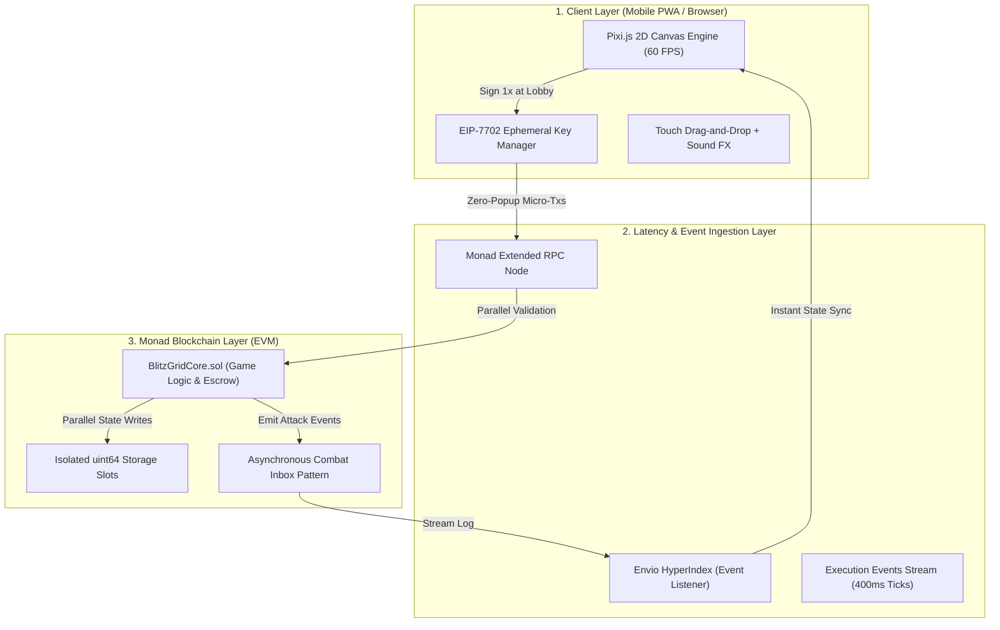

# Arsitektur Sistem & Rekayasa Teknis — BlitzGrid

---

## 1. Ikhtisar Arsitektur Tingkat Tinggi (High-Level Architecture)

BlitzGrid dirancang dari awal untuk memaksimalkan seluruh keunggulan teknis arsitektur **Monad (10.000 TPS, waktu blok 400ms, dan finalitas 800ms)**. Sistem terdiri dari empat pilar utama yang saling terhubung:



---

## 2. Inti Inovasi 1: Representasi Bitwise Papan `uint64`

Mayoritas game grid Web3 gagal karena menyimpan papan dalam bentuk array multidimensi (`uint8[8][8]` atau `mapping(uint => mapping(uint => uint))`). Pola naif tersebut memicu ratusan operasi SLOAD/SSTORE yang boros gas dan lambat.

### 2.1 Formula Matematika Bitwise
BlitzGrid mengompresi seluruh papan 8x8 kotak ke dalam **SATU variabel `uint64` (8 byte)**:
* Bit ke-$i$ bernilai `0` jika petak kosong.
* Bit ke-$i$ bernilai `1` jika petak terisi balok atau batu sabotase.
* Indeks bit dihitung dengan: $\text{Index} = y \times 8 + x$.

### 2.2 Efisiensi Gas Komputasi
Semua operasi permainan dieksekusi menggunakan operator logika biner EVM berkos rendah:

1. **Validasi Tabrakan (Collision Check):**
   ```solidity
   // pieceMask adalah representasi uint64 dari balok pada posisi (x, y)
   // Hanya butuh 1 operasi AND dan 1 operasi ISZERO (~6 gas)
   require((playerBoard & pieceMask) == 0, "Collision Detected");
   ```

2. **Penempatan Balok (State Placement):**
   ```solidity
   // Hanya butuh 1 operasi OR (~3 gas)
   playerBoard = playerBoard | pieceMask;
   ```

3. **Deteksi dan Pembersihan Baris (Row Clearance):**
   Pengecekan baris menggunakan masker horizontal `0xFF` yang digeser setiap 8 bit:
   ```solidity
   for (uint8 r = 0; r < 8; r++) {
       uint64 rowMask = uint64(0xFF) << (r * 8);
       if ((playerBoard & rowMask) == rowMask) {
           playerBoard &= ~rowMask; // Hapus baris seketika
           linesCleared++;
       }
   }
   ```

4. **Deteksi dan Pembersihan Kolom (Column Clearance):**
   Pengecekan kolom menggunakan masker vertikal `0x0101010101010101` yang digeser setiap 1 bit:
   ```solidity
   for (uint8 c = 0; c < 8; c++) {
       uint64 colMask = uint64(0x0101010101010101) << c;
       if ((playerBoard & colMask) == colMask) {
           playerBoard &= ~colMask; // Hapus kolom seketika
           linesCleared++;
       }
   }
   ```

**Dampak:** Biaya eksekusi satu langkah turn penempatan balok stabil di angka **3.800 – 4.900 gas**, setara dengan kurang dari Rp 0,5 di jaringan Monad!

---

## 3. Inti Inovasi 2: *Asynchronous Combat Inbox Pattern* (Solusi State Contention Monad)

### 3.1 Masalah State Contention pada EVM Paralel
Monad menggunakan konsensus **Optimistic Parallel Execution**. Jika Transaksi A mencoba memodifikasi slot penyimpanan yang sedang dibaca/ditulis oleh Transaksi B pada blok yang sama, validator mendeteksi *read-write conflict*, sehingga Transaksi B harus dibatalkan dan dieksekusi ulang (*re-execution*).

Jika Pemain A menyerang Pemain B dengan menulis langsung ke status Pemain B (`boards[PlayerB].rocks += 1`), saat Pemain B juga sedang menaruh balok di papannya sendiri, **terjadi tabrakan memori parah!**

### 3.2 Pola Solusi BlitzGrid: Isolasi Memori Mutlak
Untuk menjamin 100% paralelisme tanpa pernah terjadi *re-execution*, BlitzGrid menerapkan aturan ketat: **Setiap transaksi pemain HANYA BOLEH menulis ke slot memorinya sendiri.**

```
[ Blok N (Detik 0.0) ]
Pemain A menaruh balok & picu serangan:
  -> Memperbarui: boards[PlayerA] (milik A)
  -> Mengeluarkan Event: emit AttackDispatched(roundId, PlayerA, PlayerB, stoneCount: 2)
  -> Menulis Outbox: attackOutbox[PlayerA] = AttackData(...)
  (Pemain A SAMA SEKALI TIDAK MENYENTUH slot memori PlayerB!)
  HASIL: Transaksi Pemain A dieksekusi paralel sempurna.

[ Blok N+1 (Detik 0.4) ]
Pemain B mengirim transaksi langkah balok miliknya:
  -> Smart contract membaca event serangan yang masuk untuk PlayerB
  -> Transaksi B menerapkan batu ke boards[PlayerB] oleh Pemain B sendiri!
  HASIL: Transaksi Pemain B dieksekusi paralel sempurna.
```

Dengan pola **Combat Inbox** ini, 16 hingga 32 pemain yang saling serang di dalam satu lobi diproses oleh validator Monad dalam **jalur paralel 100% independen tanpa saling mengunci (*zero lock contention*)**.

---

## 4. Abstraksi Akun & Manajemen Sesi (EIP-7702 Zero Pop-Up)

Agar game berkecepatan 60 detik ini tidak rusak oleh jendela konfirmasi MetaMask yang mengganggu, BlitzGrid mengimplementasikan standar **EIP-7702 Account Delegation**:

1. **Lobby Sign-In (1x Signature):**
   * Saat pemain menekan tombol *"Enter Tournament"* di lobi, klien membuat pasangan kunci sementara (*ephemeral keypair*) di penyimpanan lokal terenkripsi browser (LocalStorage / IndexedDB).
   * Pemain menandatangani otorisasi EIP-7702 yang mendelegasikan izin eksekusi transaksi mikro dari alamat EOA pemain kepada *ephemeral key* tersebut.
2. **Session Scoping & Safety Rules:**
   * Izin didelegasikan dengan parameter restriksi ketat:
     * Hanya berlaku untuk memanggil fungsi `makeMove()` dan `fireWeapon()` pada alamat kontrak `BlitzGridGame.sol`.
     * Memiliki masa kedaluwarsa otomatis dalam 120 detik (1 ronde + jeda lobi).
     * Memiliki batas pengeluaran gas maksimum (gas allowance) sebesar 0.05 MON.
3. **Execution Loop di Layar:**
   * Selama 60 detik pertandingan, setiap kali jari pemain melepas balok di atas papan atau mengetuk tombol tembak senjata, *ephemeral key* langsung menandatangani transaksi mikro dan mengirimkannya ke node Monad via RPC `eth_sendRawTransactionSync` dalam waktu **< 50 milidetik tanpa ada pop-up dompet sama sekali**.

---

## 5. Sinkronisasi Latensi Rendah & Deteksi Event Real-Time

Untuk menerjemahkan peristiwa blockchain menjadi animasi pertarungan yang responsif di layar HP pemain:
* **Pemanfaatan `eth_sendRawTransactionSync`:** Monad mendukung metode RPC sinkron di mana tanda terima transaksi (*transaction receipt*) dikembalikan pada respons HTTP yang sama saat transaksi dikirim, memberikan umpan balik langsung ke UI dalam hitungan milidetik.
* **Envio HyperIndex:** Pengindeks acara on-chain berbasis Rust/Wasm yang mengamati log `AttackDispatched` dan `PlayerEliminated`. Data ini disalurkan langsung ke klien WebSocket untuk memicu animasi laser dan batu jatuh di layar pemain target secara real-time.
* **Optimistic Local Simulation:** Klien Pixi.js langsung merender balok dan menghancurkan garis secara lokal di layar pemain pada detik ke-0 (0ms), lalu melakukan rekonsiliasi hash status dengan smart contract pada blok 400ms berikutnya. Jika terjadi manipulasi memori lokal di HP, smart contract menolak state hash tersebut dan mendiskualifikasi pemain seketika.

---

## 6. Protokol Penanganan Desync & Anti-Cheat

1. **Deterministic Random Seed:**
   * Di awal ronde, kontrak mengunci `roundSeed = block.prevrandao ^ block.timestamp`.
   * Urutan 3 balok yang dibagikan ke tangan pemain dihitung secara deterministik dari seed tersebut. Klien tidak bisa memalsukan bentuk balok karena kontrak akan memvalidasi apakah bentuk balok yang ditaruh sesuai dengan urutan seed.
2. **Penanganan Koneksi Putus (Disconnect Recovery):**
   * Jika HP pemain kehilangan sinyal internet selama ronde berlangsung, blitz timer 4 detik per giliran tetap berjalan di smart contract.
   * Kontrak secara otomatis memasang balok pertama acak untuk setiap 4 detik jeda hingga pemain tersambung kembali atau papan tereliminasi (*auto-failover*).
