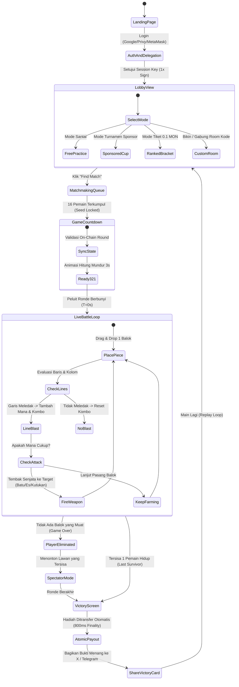

# Alur Permainan & Pengalaman Pengguna (Flow Gameplay) — BlitzGrid

---

## 1. Diagram State Machine Permainan

---

## 2. Rincian Fase Perjalanan Pemain (Player Journey)

### Fase 1: Onboarding Kilat & Pembuatan Akun (Detik 0 – 3)
1. **Akses:** Pemain membuka URL web `blitzgrid.xyz` di browser HP (Safari iOS atau Chrome Android) atau scan QR code di layar hackathon.
2. **One-Click Auth:** Pemain memilih login menggunakan akun **Google, Twitter (X), atau Email** via Privy. Bagi pengguna crypto native, tersedia opsi tombol *"Connect Web3 Wallet"* (MetaMask / Rabby).
3. **Penyediaan Saldo:** 
   * Untuk pengguna baru di Testnet Monad: Smart contract faucet internal otomatis memberikan *airdrop* percobaan 1 MON untuk langsung bisa menjajal turnamen.
   * Untuk Mainnet: Pemain dapat mendanai dompet menggunakan integrasi on-ramp instan atau transfer MON langsung.

---

### Fase 2: Pemilihan Lobi & Pendelegasian Sesi (Detik 4 – 8)
1. **Pilihan Menu Lobi:**
   * **Free Practice:** Latihan bebas tanpa risiko untuk mengasah kelincahan jari.
   * **Sponsored Cups:** Turnamen harian berhadiah 50–100 MON yang disponsori ekosistem mitra Monad (gratis tiket masuk).
   * **Ranked Blitz:** Turnamen berperingkat kompetitif dengan tiket masuk 0.1 MON (sekitar Rp 500).
   * **Custom Room:** Membuat ruang privat bersama teman menggunakan 6-digit Room Code.
2. **Otorisasi Sesi (EIP-7702):**
   * Saat pemain mengonfirmasi masuk lobi, muncul pop-up izin dompet **UNTUK PERTAMA DAN TERAKHIR KALINYA**.
   * Pemain menandatangani sesi pendelegasian yang mengizinkan *ephemeral key* lokal untuk mengeksekusi transaksi langkah balok dan serangan sabotase di kontrak `BlitzGridGame.sol` selama 120 detik.
   * **Hasil:** Setelah klik tombol ini, **TIDAK AKAN ADA LAGI POP-UP DOMPET** sampai ronde selesai.

---

### Fase 3: Antrean Matchmaking & Penguncian Seed (Detik 9 – 15)
1. **Lobby Assembly:** Sistem matchmaking otomatis memasangkan 16 pemain yang memiliki rentang skor seimbang ke dalam satu lobi pertandingan.
2. **Penguncian Seed On-Chain:** Kontrak mengunci `roundSeed` dari hash blok Monad terkini. Seed ini menentukan urutan balok yang akan dibagikan ke tangan setiap pemain secara adil dan terverifikasi.
3. **Hitung Mundur 3-2-1:** Layar HP menampilkan hitungan mundur 3 detik dengan animasi petir neon ungu, diiringi audio detak jantung yang memacu adrenalin.

---

### Fase 4: Pertarungan Hidup-Mati 60 Detik (Live Blitz Battle Loop)
Ini adalah puncak intensitas permainan:

1. **Layar HUD Pertandingan:**
   * **Tengah Layar:** Papan grid 8x8 milik pemain, responsif terhadap gesekan jempol.
   * **Bawah Layar:** 3 balok neon aktif yang siap dipasang, disertai pengukur waktu giliran (*Blitz Timer* 4 detik).
   * **Kanan Bawah:** Indikator *Mempool Mana Bar* dan 3 tombol senjata sabotase (*Glitch Stone*, *Toxic Hand*, *Frost Lock*).
   * **Sisi Kiri & Atas:** 15 radar mini transparan yang menampilkan kondisi papan lawan-lawanmu secara langsung, lengkap dengan garis laser penargetan.
2. **Aksi & Respon Sub-Detik:**
   * Pemain menyeret balok ke posisi kosong. Begitu balok terpasang, sistem lokal langsung merespon dalam 0ms, dan transaksi mikro divalidasi oleh Monad dalam 400ms.
   * Saat garis mendatar/tegak meledak, terdengar audio dentuman renyah dan partikel neon beterbangan. Angka kombo naik: *"Combo x2! Combo x3!"*
3. **Meluncurkan Serangan:**
   * Pemain memilih mode bidikan (misal: mode *K.O. Hunter* untuk mengincar musuh paling sekarat).
   * Begitu Mana terkumpul 30, pemain mengetuk ikon **Glitch Stone**. Laser ungu menyambar keluar dari papan pemain melintasi layar menuju papan musuh yang dibidik.
4. **Menerima Serangan Musuh:**
   * Terdengar suara sirene peringatan: *"INCOMING SABOTAGE!"*
   * Pada langkah giliran berikutnya, batu abu-abu jatuh menimpa petak kosong papan pemain, mempersempit ruang gerak pemain dan memaksa improvisasi taktik seketika.

---

### Fase 5: Momen Eliminasi & Mode Penonton (Spectator Mode)
1. **Eliminasi (Top Out):**
   * Jika ketiga balok di tangan pemain tidak muat dipasang di sisa celah kosong papan, layar bergetar hebat dengan efek pecahan kaca merah dan teks besar: **ELIMINATED!**
   * Status pemain terkunci di blockchain pada urutan peringkat gugur (misal: Peringkat #7 dari 16).
2. **Seamless Spectator:**
   * Pemain yang gugur tidak langsung ditendang keluar, melainkan otomatis beralih ke **Mode Penonton Dinamis**.
   * Pemain bisa menyaksikan duel 1v1 detik-detik terakhir antara 2 pemain teratas dengan sudut pandang layar penuh, memberikan hiburan seru layaknya menonton turnamen esports langsung.

---

### Fase 6: Kemenangan, Pembagian Hadiah, dan Virality Loop
1. **Layar Kemenangan (Royale Victor):**
   * Pemain terakhir yang bertahan disambut dengan ledakan konfeti emas dan teks: **VICTORY ROYALE!**
   * Ditampilkan statistik lengkap pertandingan: Total Garis Meledak, Kombo Tertinggi, Jumlah Kill, dan Total Mana yang Dihasilkan.
2. **Penyelesaian Hadiah Atomik (800ms):**
   * Tanpa perlu menekan tombol *"Withdraw"* atau menunggu verifikasi admin, smart contract `BlitzGridVault.sol` **langsung mentransfer 65% total pot MON ke dompet pemenang** dalam 2 blok Monad (800 milidetik).
   * Notifikasi transaksi sukses muncul hijau di sudut layar.
3. **Kartu Bukti Kemenangan (Shareable Victory Card):**
   * Klien secara otomatis menghasilkan kartu grafik estetis beresolusi tinggi yang merangkum kemenangan pemain.
   * Terdapat tombol 1-klik: **"Share to X / Farcaster"** dengan teks otomatis:  
     > *"Baru aja nyapu bersih 16 pemain di BlitzGrid Monad! 65% prize pool masuk dompet dalam 800ms. Siapa berani duel di grid 8x8? #MonadBlitz #BlitzGrid"*
4. **Tombol "Play Again" (Retensi Tanpa Batas):**
   * Pemain disuguhkan tombol besar *"Play Again"*, yang langsung melemparkan mereka kembali ke antrean matchmaking baru dalam waktu 2 detik.
